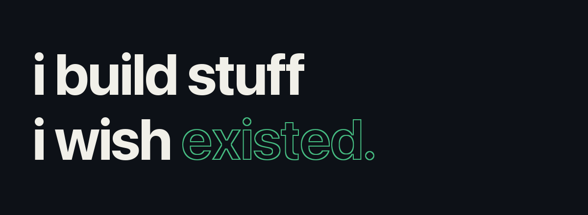

<picture>
  <source media="(prefers-reduced-motion: reduce) and (prefers-color-scheme: light)" srcset="header-light.png">
  <source media="(prefers-reduced-motion: reduce)" srcset="header-dark.png">
  <source media="(prefers-color-scheme: light)" srcset="header-light.gif">
  
</picture>

Business & Technology at **NYU Tandon**. Exploring ideas through things I build.

### Selected work

**[Riyadh Operations Digital Twin](https://github.com/basmaalmandil/riyadh-ops-digital-twin)**  
Making Riyadh’s municipal data easier to explore through maps, district comparisons, and an interactive dashboard.

[Explore the demo ↗](https://riyadh-ops-digital-twin.bmohammedalmandil.chatgpt.site)

---

[Website ↗](https://miftksa.com) &nbsp; · &nbsp; [LinkedIn ↗](https://linkedin.com/in/basmaalmandil) &nbsp; · &nbsp; [More projects ↗](https://github.com/basmaalmandil?tab=repositories)
